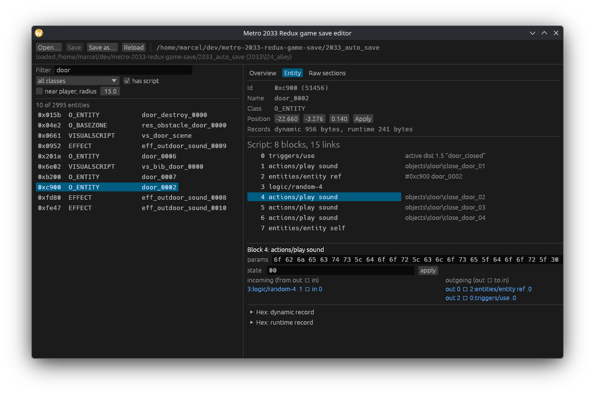

# Metro 2033 Redux game save editor

> [!NOTE]
> **This project is vibe coded.** It was written mostly by an AI assistant in a single session.
> The main goal was to fix a bug in my own save game (a stuck script in the Library, see
> [below](#case-study-stuck-script-in-the-library)) without replaying the mission from the start.
> It worked for me, but expect rough edges, and **always keep a backup of your save**.



Inspect, edit and repack **Metro 2033 Redux** save games (`2033_auto_save`, …).
A GUI (egui) and a CLI in one binary.

## Build

Requires a recent Rust toolchain.

```sh
cargo build --release
target/release/metro-2033-redux-save-editor                       # GUI
target/release/metro-2033-redux-save-editor gui 2033_auto_save --select vs_room_scene
target/release/metro-2033-redux-save-editor --help                # CLI
```

Build without the GUI with `cargo build --release --no-default-features`.

## Where are the saves?

On Linux (Steam / Proton) the saves live in
`<Steam library>/steamapps/common/Metro 2033 Redux/<steam id>/`.

* Close the game before replacing a save.
* If Steam Cloud reports a conflict, keep the local file.

## CLI

| command | description |
|---|---|
| `info SAVE` / `verify SAVE` | summary / lossless decode-encode check |
| `unpack SAVE DIR`, `pack DIR OUT` | decompressed sections as files (`header.bin`, `dynamic.bin`, `active.bin`, `layout.txt`) and back |
| `list SAVE [--class C] [--name S] [--near player --radius 10]` | list entities |
| `entity SAVE NAME [--hex]` | show one entity |
| `script SAVE NAME [--links]` | visual script: blocks, parameters, runtime state, links |
| `set-trigger SAVE -s SCRIPT -b N --active true` | switch a trigger on/off |
| `arm-delay SAVE -s SCRIPT -b N [--timer 100]` | enable a delay and start it (running timers apparently don't survive loading, see below) |
| `set-state` / `set-param SAVE -s SCRIPT -b N [--offset K] --hex ..` | raw block edits (same size) |
| `set-pos SAVE NAME x y z` | move an entity (for NPCs also the runtime position copy) |
| `patch SAVE --section active --offset 0x.. --hex ..` | raw edit of a decompressed section (re-parsed afterwards) |
| `dict METRO_BINARY OUT` | build `metro_names.txt` from the game executable for better name lookup |

Edit commands write to `-o FILE`, or modify the input in place after copying it to `FILE.bak`.
Every write is re-parsed before it is stored.

## Case study: stuck script in the Library

**Symptom:** Miller and Danila stand in the room before the hall, the hall door is already
open, and shooting the chandelier only makes it swing. Nothing else happens.

**Cause:** the chandelier's hit trigger (`vs_lustra` block 0) feeds a `logic/locker_base` that
does not lock after the first pass, so *every* hit restarts the sequence. Each pass sends
`stalker_move`, which walks Miller and Danila back to their spots in the room and interrupts
their scared reactions to the door breaking (`vs_room_scene` blocks 40 and 204). Those reactions
are what start their walk into the hall, and block 204 sits behind a locker that only passes
once. So shooting the chandelier a second time leaves the scene stuck for good. The room has
an autosave zone that saves on every entry, so walking back in saved the broken state.

**Repair:** put Danila into the zone in the hall that normally fires `scared_before_ladder` when
she walks in (`restrictor_0001`). That signal starts the rest of the scene: Miller kicks in the
next door and both continue.

```sh
metro-2033-redux-save-editor set-pos     2033_auto_save npc_danila -34.602 -3.275 18.564 -o fixed  # into restrictor_0001
metro-2033-redux-save-editor set-param   fixed -s vs_room_scene -b 229 --hex 0a -o fixed           # fire scared_before_ladder only once
metro-2033-redux-save-editor set-trigger fixed -s vs_lustra -b 0  --active false -o fixed          # shooting the chandelier no longer
metro-2033-redux-save-editor set-trigger fixed -s vs_lustra -b 30 --active false -o fixed          # resets the NPCs
```

Then replace `2033_auto_save` with `fixed` (keep a copy of the original), load it and don't
shoot the chandelier.

**What did not work:** my first attempt armed delays (`arm-delay`) so the script would continue
after loading. Nothing happened. Every delay in the save is idle, so the game apparently does
not keep running timers in a save. Restart a script with something that happens after loading
instead: an NPC or the player entering a zone, or a hit.

If nothing helps, the fallback is chapter select → *Alley*, which restarts the
chapter with the inventory from `2033_l24_alley.player`.

## File format

Reverse engineered from my own saves, so it may be incomplete.

```
"DEZP"
3 × { u32 uncompressed size, u32 crc32(section name), u32 compressed size }   header, dynamic, active
per section: chunks { u32 chunk size incl. 8 byte header, u32 uncompressed size, LZ4 block }
             (blocks of a section are linked: they may reference the previous 64 KiB of output)
u32 crc32 (zlib) of everything before
```

All names are stored as CRC32 (zlib) of the text: section names, entity classes
(`O_ENTITY`, `VISUALSCRIPT`, …), script block types (`triggers/use`, `logic/delay`, …).

* **header**: level (`2033\l24_alley`), build tag, environment and music names.
* **dynamic**: sub chunks `sub_chunk_dynamic` with entity slots `{u16 key, blob}`.
  `blob = u32 size, u32 0x4b11a930, u8 0xd4, u32 size-9, payload`.
  Entity header: `u32 class, u32 static key, char bone[], u16 id, u16 parent, …, char name[], u16 flags, f32 transform[12]`.
  For cloned entities the slot key is the template id; the id inside the header is the real one.
* **active**: sub chunks `sub_chunk_active` with runtime records `{u16 id, u16 template id, blob}`.

### Visual scripts

Definition (in the entity record): marker `14 00 ff ff ff ff`, `u32 n`, n × `{u32 type, u32 0, params}`,
`u32 m`, m × `{u16 from, u16 out_pin, u16 to, u16 in_pin}`.
Runtime (in the active record): `u32 n`, then each block's state. State sizes per block type are in
`src/script.rs` (`state_size`); entity references store `u32 count, u16 ids[]`.

Semantics that matter for fixing stuck scripts (from the Metro Exodus SDK docs, checked against saves):

* triggers: param byte 0 = active; state byte 0 = currently active; input pin 0 = activate, 1 = deactivate
* `logic/delay`: params `u32 min_ms, u32 max_ms, u8 flags` (`0x02` active); state `u8 active, i32 timer` (`-2` = idle; always idle in saves)
* `logic/and-2`: inputs on pins 2 and 3; state looks like a bit mask of received inputs (`03` after firing)
* `triggers/object`: fires when the watched object enters the zone, also for an object that is already inside when the save loads
* `logic/locker` ("heavy"): inputs lock / unlock / in; `logic/locker_base` ("easy"): flag `0x08` = lock after first pass
* 1-byte state of actions: `1` while running / after running (depends on the action)

## Tests

```sh
cargo test
```

The tests use a save named `2033_auto_save` in the repository root and are skipped when it is missing.
Save files are not included in this repository.

## Disclaimer

Not affiliated with 4A Games, Deep Silver or Plaion. Use at your own risk: edited saves
may break your game progress.

## License

MIT
